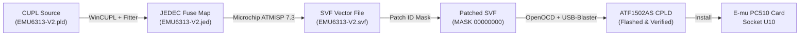

# E-mu PC510 / SK510 Rev A — CPLD Replacement & Flashing Guide
**Drop-in Replacement of Altera EPM7032LC44 (`U10`) with Atmel/Microchip ATF1502AS**

---

## 1. Executive Summary & Purpose

The **E-mu PC510 / SK510 Rev A** is the Digital Audio & 8-Analog Output expansion board used in the **E-mu Emulator IV, E5000 Ultra, E6400, and E-Synth** series samplers. 

On this board, IC **`U10`** is an Altera **EPM7032LC44** PLD (PLCC-44 package) acting as the primary bus bridge:
1. **Address Decoder**: Generates active-low chip select and strobe signals (`BUFOEN`, `CSHCHPN`, `WRPAGEN`).
2. **Transparent Address Latch**: Latches host address lines `A1`–`A9` into `LA1`–`LA9` for the downstream E-mu H-CHIP 1.5 ASICs.
3. **Read Strobe Latch**: Latches bus read direction `RD` into `LRD`.

Because the original EPM7032 (Altera MAX 7000 family) is obsolete and unprogrammable with modern tools, the **Microchip/Atmel ATF1502AS-10JU44** (5V, 32 Macrocell, PLCC-44) is the ideal modern, in-production drop-in replacement.



---

## 2. Toolchain & Bill of Materials

### Software Requirements
| Tool | Version | Vendor | Function |
| :--- | :--- | :--- | :--- |
| **WinCUPL** | 5.0a | Logical Devices / Atmel | CUPL IDE and logic compiler |
| **ATF1502 Fitter** | 1918 (`fit1502.exe`) | Atmel / Microchip | Fits logic into ATF1502 architecture (`.fit`, `.jed`) |
| **ATMISP** | 7.3 | Microchip | Generates Serial Vector Format (`.svf`) from `.jed` |
| **OpenOCD** | 0.12.0 | Open Source | JTAG debugger & SVF player |
| **Text Editor** | Notepad / VSCode | Any | SVF patching & configuration editing |

### Hardware Requirements
| Item | Details |
| :--- | :--- |
| **Target CPLD** | Atmel / Microchip **ATF1502AS-10JU44** (PLCC-44, 5V, 10ns) |
| **JTAG Programmer** | **Altera USB-Blaster** (clone or genuine, FTDI FT245 + CPLD/MCU architecture) |
| **Socket / Adapter** | PLCC-44 to breadboard adapter or PLCC-44 programming clip |
| **Power Supply** | Clean +5.0V DC regulated supply for the CPLD VCC during flashing |

---

## 3. Physical Pinout & Schematic Mapping

The pinout below reflects the physical wiring on the E-mu PC510 schematic (**Sheet 2: Expansion Bus Interface** and **Sheet 4: H-Chips**).

```
                            ATF1502AS (PLCC-44)
                               Top View

                              01  44  43  42  41
                          +------------------------+
                  OE2   2 |                        | 40  LA9
                  VCC   3 |                        | 39  LA6
               EXPCSN   4 |                        | 38  CSHCHPN
                IORDN   5 |                        | 37  LRD
                   A1   6 |                        | 36  LA5
                   A3   7 |                        | 35  VCC
                   A2   8 |       ATF1502AS        | 34  LA2
                   A5   9 |        PLCC-44         | 33  LA3
                  GND  10 |                        | 32  WRPAGEN
                   A4  11 |                        | 31  LA1
                   A7  12 |                        | 30  GND
                          +------------------------+
                              13  14  16  17  18
```

### Complete Pin Assignment Table

| Pin # | Signal Name | Type | Board Origin / Destination | Role |
| :---: | :--- | :---: | :--- | :--- |
| **1** | `UPCLRN` | Input | System Reset via R7 | Global Asynchronous Clear / Reset |
| **2** | `OE2` | Input | Tied to `UPCLRN` | Global Output Enable 2 |
| **3** | `VCC` | Power | +5V Rail | Core & I/O Power |
| **4** | `EXPCSN` | Input | CN4-48 | Host Expansion Card Chip Select (Active Low) |
| **5** | `IORDN` | Input | CN4-45 via R9 | I/O Read Strobe (Active Low) |
| **6** | `A1` | Input | CN4-41 | Host Address Bit 1 |
| **7** | `A3` *(TDI)* | Input | CN4-37 | Host Address Bit 3 *(Reused JTAG TDI)* |
| **8** | `A2` | Input | CN4-38 | Host Address Bit 2 |
| **9** | `A5` | Input | CN4-35 | Host Address Bit 5 |
| **10** | `GND` | Power | System Ground | Ground |
| **11** | `A4` | Input | CN4-36 | Host Address Bit 4 |
| **12** | `A7` | Input | CN4-33 | Host Address Bit 7 |
| **13** | `A6` *(TMS)* | Input | CN4-34 | Host Address Bit 6 *(Reused JTAG TMS)* |
| **14** | `A9` | Input | CN4-29 | Host Address Bit 9 |
| **15** | `VCC` | Power | +5V Rail | Core & I/O Power |
| **16** | `A8` | Input | CN4-30 | Host Address Bit 8 |
| **17** | `A11` | Input | CN4-27 | Host Address Bit 11 |
| **18** | `A10` | Input | CN4-28 | Host Address Bit 10 |
| **19** | `A13` | Input | CN4-25 | Host Address Bit 13 |
| **20** | `A12` | Input | CN4-26 | Host Address Bit 12 |
| **21** | `IOWRN` | Input | CN4-46 via R11 | I/O Write Strobe (Active Low) |
| **22** | `GND` | Power | System Ground | Ground |
| **23** | `VCC` | Power | +5V Rail | Core & I/O Power |
| **24** | `RD` | Input | CN4-44 via R12 | Bus Direction (High = Read, Low = Write) |
| **25** | `LA8` | Output | Drives R71 (47Ω) | Latched Address Bit 8 |
| **26** | `LA7` | Output | Drives R21 (47Ω) | Latched Address Bit 7 |
| **27** | `BUFOEN` | Output | Drives R70 to U13 | Data Bus Buffer Enable (`74ACTQ16245`) |
| **28** | `NC` | Spare | Unconnected | Spare / Unused Pin |
| **29** | `LA4` | Output | Drives R22 (47Ω) | Latched Address Bit 4 |
| **30** | `GND` | Power | System Ground | Ground |
| **31** | `LA1` | Output | Drives R20 (47Ω) | Latched Address Bit 1 |
| **32** | `WRPAGEN` *(TCK)*| Output | Drives U9 CLK (R60) | Write Page Register Strobe *(Reused JTAG TCK)* |
| **33** | `LA3` | Output | Drives R19 (47Ω) | Latched Address Bit 3 |
| **34** | `LA2` | Output | Drives R18 (47Ω) | Latched Address Bit 2 |
| **35** | `VCC` | Power | +5V Rail | Core & I/O Power |
| **36** | `LA5` | Output | Drives R17 (47Ω) | Latched Address Bit 5 |
| **37** | `LRD` | Output | Drives R16 (47Ω) | Latched Read Strobe to H-Chips |
| **38** | `CSHCHPN` *(TDO)*| Output | Drives R15 to H-Chips | H-Chips Chip Select *(Reused JTAG TDO)* |
| **39** | `LA6` | Output | Drives R14 (47Ω) | Latched Address Bit 6 |
| **40** | `LA9` | Output | Drives R13 (47Ω) | Latched Address Bit 9 |
| **41** | `HWAITN` | Input | From sheets 3,4 & CN4-21 | Hardware Wait (Active Low) |
| **42** | `GND` | Power | System Ground | Ground |
| **43** | `GCLK` | Input | 22.5792 MHz (C22M2 via R61) | Global Master Clock (Optional / Spare) |
| **44** | `OE1` | Input | Tied to `UPCLRN` | Global Output Enable 1 / High Voltage Override |

---

## 4. Complete CUPL Source Code (`EMU6313-V2.pld`)

Save this file as `C:\Users\kongi\Documents\EMU6313-V2.pld`:

```cupl
Name     EMU6313-V2 ;
PartNo   SK510_REV_A ;
Date     10/06/2026 ;
Revision 04 ;
Designer E-mu Systems / Reverse Engineered ;
Company  E-mu Systems, Inc. ;
Assembly PC510 ;
Location U10 ;
Device   f1502ispplcc44 ;

/* ************************************************************************** */
/* E-mu Emulator IV / E5000 / E6400 Digital Audio Interface (PC510 / SK510)  */
/* Sheet 2: Address Decoder, Address Latch, and Data Bus Buffer Control       */
/* Target Device: Altera EPM7032LC44 / Microchip/Atmel ATF1502AS-PLCC44       */
/* ************************************************************************** */

/* ========================================================================== */
/* INPUT PINS                                                                 */
/* ========================================================================== */
Pin 1  = UPCLRN ;   /* Dedicated Clear / Reset (GCLR), from CN4-50 via R7    */
Pin 2  = OE2 ;      /* Dedicated Global Output Enable 2, tied to UPCLRN       */
Pin 4  = EXPCSN ;   /* Expansion Card Chip Select (Active Low), from CN4-48   */
Pin 5  = IORDN ;    /* I/O Read Strobe (Active Low), from CN4-45 via R9       */
Pin 6  = A1 ;       /* Address bit 1, from CN4-41                             */
Pin 7  = A3 ;       /* Address bit 3, from CN4-37                             */
Pin 8  = A2 ;       /* Address bit 2, from CN4-38                             */
Pin 9  = A5 ;       /* Address bit 5, from CN4-35                             */
Pin 11 = A4 ;       /* Address bit 4, from CN4-36                             */
Pin 12 = A7 ;       /* Address bit 7, from CN4-33                             */
Pin 13 = A6 ;       /* Address bit 6, from CN4-34                             */
Pin 14 = A9 ;       /* Address bit 9, from CN4-29                             */
Pin 16 = A8 ;       /* Address bit 8, from CN4-30                             */
Pin 17 = A11 ;      /* Address bit 11, from CN4-27                            */
Pin 18 = A10 ;      /* Address bit 10, from CN4-28                            */
Pin 19 = A13 ;      /* Address bit 13, from CN4-25                            */
Pin 20 = A12 ;      /* Address bit 12, from CN4-26                            */
Pin 21 = IOWRN ;    /* I/O Write Strobe (Active Low), from CN4-46 via R11     */
Pin 24 = RD ;       /* Read/Write Direction (High = Read), from CN4-44 via R12*/
Pin 41 = HWAITN ;   /* Hardware Wait (Active Low), from sheets 3,4 & CN4-21   */
Pin 43 = GCLK ;     /* Global Clock 1, 22.5792 MHz (C22M2 via R61 150 ohm)   */
Pin 44 = OE1 ;      /* Dedicated Global Output Enable 1, tied to UPCLRN       */

/* ========================================================================== */
/* OUTPUT PINS                                                                */
/* ========================================================================== */
Pin 25 = LA8 ;      /* Latched Address bit 8 -> drives R71 (47 ohm)           */
Pin 26 = LA7 ;      /* Latched Address bit 7 -> drives R21 (47 ohm)           */
Pin 27 = BUFOEN ;   /* Data Buffer Output Enable (Active Low) -> drives R70   */
Pin 28 = NC ;       /* Unconnected / Spare pin                                */
Pin 29 = LA4 ;      /* Latched Address bit 4 -> drives R22 (47 ohm)           */
Pin 31 = LA1 ;      /* Latched Address bit 1 -> drives R20 (47 ohm)           */
Pin 32 = WRPAGEN ;  /* Write Page Enable (Active Low) -> drives U9 CLK (R60)  */
Pin 33 = LA3 ;      /* Latched Address bit 3 -> drives R19 (47 ohm)           */
Pin 34 = LA2 ;      /* Latched Address bit 2 -> drives R18 (47 ohm)           */
Pin 36 = LA5 ;      /* Latched Address bit 5 -> drives R17 (47 ohm)           */
Pin 37 = LRD ;      /* Latched Read -> drives R16 (47 ohm) to sheets 3,4      */
Pin 38 = CSHCHPN ;  /* Chip Select H-Chips (Active Low) -> drives R15 (47 ohm)*/
Pin 39 = LA6 ;      /* Latched Address bit 6 -> drives R14 (47 ohm)           */
Pin 40 = LA9 ;      /* Latched Address bit 9 -> drives R13 (47 ohm)           */

/* ========================================================================== */
/* DECODE LOGIC                                                               */
/* Range: 0x540000 - 0x543FFF                                                 */
/* ========================================================================== */

/* 1. DATA BUS BUFFER ENABLE (0x540000 - 0x5407FF)                            */
!BUFOEN = !EXPCSN & !A13 & !A12 & !A11 ;

/* 2. CHIP SELECT H-CHIPS (0x540400 - 0x5407FF)                               */
!CSHCHPN = !EXPCSN & !A13 & !A12 & !A11 & A10 ;

/* 3. WRITE PAGE REGISTER (0x540000 - 0x5403FF, Write Only)                   */
!WRPAGEN = !EXPCSN & !A13 & !A12 & !A11 & !A10 & !IOWRN ;

/* ========================================================================== */
/* TRANSPARENT ADDRESS & CONTROL LATCHES                                      */
/* Transparent when bus is idle (EXPCSN=1 & HWAITN=1), locked during cycles.  */
/* ========================================================================== */
LATCH_EN = EXPCSN & HWAITN ;

LA1 = (LATCH_EN & A1) # (!LATCH_EN & LA1) ;
LA2 = (LATCH_EN & A2) # (!LATCH_EN & LA2) ;
LA3 = (LATCH_EN & A3) # (!LATCH_EN & LA3) ;
LA4 = (LATCH_EN & A4) # (!LATCH_EN & LA4) ;
LA5 = (LATCH_EN & A5) # (!LATCH_EN & LA5) ;
LA6 = (LATCH_EN & A6) # (!LATCH_EN & LA6) ;
LA7 = (LATCH_EN & A7) # (!LATCH_EN & LA7) ;
LA8 = (LATCH_EN & A8) # (!LATCH_EN & LA8) ;
LA9 = (LATCH_EN & A9) # (!LATCH_EN & LA9) ;

LRD = (LATCH_EN & RD) # (!LATCH_EN & LRD) ;

/* Tristate control: enabled when UPCLRN is High                              */
[LA1..9].oe = UPCLRN ;
LRD.oe     = UPCLRN ;
CSHCHPN.oe = UPCLRN ;
WRPAGEN.oe = UPCLRN ;
BUFOEN.oe  = UPCLRN ;
```

---

## 5. Compilation in WinCUPL

1. Launch **WinCUPL**.
2. Open `EMU6313-V2.pld`.
3. Under **Options $\rightarrow$ Devices**, verify that device **`f1502ispplcc44`** is selected.
4. Click **Run $\rightarrow$ Device Specific Compile** (or press the green compile button).
5. Inspect the output window and the generated `.fit` file (`EMU6313-V2.fit`):
   * `Fitter_Pass 1, Preassign = KEEP`
   * `JTAG = OFF`
   * `Design fits successfully`
   * **Macrocell Utilization: 40%** (13 of 32 macrocells used).
6. WinCUPL produces:
   * **`C:\Users\kongi\Documents\EMU6313-V2.jed`** (the JEDEC fuse map).

> [!IMPORTANT]
> Because pins **7 (`A3`), 13 (`A6`), 32 (`WRPAGEN`), and 38 (`CSHCHPN`)** are connected to physical circuit traces on the PC510 PCB, **`JTAG = OFF`** must be used in the fitter. This repurposes those four dedicated JTAG pins as normal I/O pins.

---

## 6. Converting JEDEC to SVF using ATMISP 7.3

OpenOCD requires an **SVF** (Serial Vector Format) file, which contains the exact JTAG state-machine vectors to erase, program, and verify the device.

1. Launch **Microchip ATMISP v7.3**.
2. Go to **File $\rightarrow$ New** to create a new JTAG chain file.
3. When prompted: *Number of devices in JTAG chain?* $\rightarrow$ Enter **`1`** and click **OK**.
4. The **Device Properties** window will appear:
   * **Device:** Select `ATF1502AS`
   * **Package:** Select `PLCC44`
   * **JTAG Instruction:** Select `Program/Verify`
   * **JEDEC File:** Browse and select `C:\Users\kongi\Documents\EMU6313-V2.jed`
   * Click **OK**.
5. In the main **Chain Window / Table**:
   * Locate the checkbox labeled: **`[ ] Write SVF file`**
   * **Tick this checkbox.**
   * A file dialog will prompt you for the output destination: save it as:
     `C:\Temp\openocd\EMU6313-V2.svf`
   * When asked *"Use STATE RESETS in SVF File?"*, select **Yes**.
6. Click the large **Run** button (or **Process $\rightarrow$ Run**).
   * ATMISP calculates the vectors and writes the operation sequence.
7. **Close / Exit ATMISP.** *(ATMISP only flushes and closes the SVF file buffer upon exit).*

---

## 7. The Silicon IDCODE Trap & The Crucial Patch

### The Problem
When ATMISP 7.3 generates the SVF file for an ATF1502AS, it hardcodes the original Atmel Device Identification check at lines 18–21:

```text
SIR 10 TDI (059);
SDR 32 TDI (ffffffff)
	TDO (0150203f)
	MASK (ffffffff);
```

However, modern production batches and low-power variations of the ATF1502AS (fabricated under Microchip / Silicon Storage Technology silicon processes) report:
* OpenOCD Tap ID: `0x03a1407f`
* Read Register TDO: `0x01a1407f` (Manufacturer `0x03F`, Part `0x3A14`)

If left unmodified, OpenOCD will halt during flashing with:
```text
Error: tdo check error at line 21
Error:     READ = 0x1a1407f
Error:     WANT = 0x3a1407f
Error:     MASK = 0xffffffff
```

### The Fix
Open **`C:\Temp\openocd\EMU6313-V2.svf`** in Notepad:
Find lines 19–21:
```text
SDR 32 TDI (ffffffff)
	TDO (0150203f)
	MASK (ffffffff);
```
Change **`MASK (ffffffff)`** to **`MASK (00000000)`**:
```text
SDR 32 TDI (ffffffff)
	TDO (01a1407f)
	MASK (00000000);
```

> [!TIP]
> Setting `MASK (00000000)` tells OpenOCD to ignore the 32-bit ID comparison entirely and continue directly to erasing and flashing. The subsequent fuse-verify passes at the end of the file remain active to ensure complete data integrity.

Save the file (**Ctrl + S**).

---

## 8. OpenOCD JTAG Flashing Setup

### 1. Wiring: USB-Blaster to ATF1502AS (PLCC-44)

Connect the 10-pin female IDC ribbon header from your USB-Blaster to your ATF1502 socket as follows:

| USB-Blaster Pin | Signal | ATF1502AS PLCC-44 Pin | Description |
| :---: | :---: | :---: | :--- |
| **Pin 1** | `TCK` | **Pin 32** | JTAG Test Clock |
| **Pin 2** | `GND` | **Pin 10 / 22 / 30 / 42** | Ground |
| **Pin 3** | `TDO` | **Pin 38** | JTAG Test Data Out |
| **Pin 4** | `VCC` | **Pin 3 / 15 / 23 / 35** | Target VCC sense (+5V) |
| **Pin 5** | `TMS` | **Pin 13** | JTAG Test Mode Select |
| **Pin 7** | `GND` | **Pin 10 / 22 / 30 / 42** | Ground |
| **Pin 9** | `TDI` | **Pin 7** | JTAG Test Data In |
| **Pin 10**| `GND` | **Pin 10 / 22 / 30 / 42** | Ground |

*(Pins 6 and 8 on the USB-Blaster header are NC / ground).*

```
        USB-Blaster 10-pin Header (Looking into Cable Socket)
                     +-----------+
            TCK (1)  | [o]   [o] | (2)  GND
            TDO (3)  | [o]   [o] | (4)  VCC (+5V Target Sense)
            TMS (5)  | [o]   [o] | (6)  NC
            NC  (7)  | [o]   [o] | (8)  NC
            TDI (9)  | [o]   [o] | (10) GND
                     +-----------+
```

---

### 2. OpenOCD Script (`program_atf.cfg`)

Save this file as `C:\Temp\openocd\program_atf.cfg`:

```tcl
# ==============================================================================
# OpenOCD Configuration for Microchip/Atmel ATF1502AS via USB-Blaster
# ==============================================================================

adapter driver usb_blaster
usb_blaster vid_pid 0x09FB 0x6001

adapter speed 50

# Disable network servers to keep output clean
gdb_port disabled
tcl_port disabled
telnet_port disabled

# TAP definition (covers both SST and standard Atmel ID codes)
jtag newtap ATF1502AS tap -irlen 3 -expected-id 0x03a1407f -expected-id 0x0150203f

# Initialize JTAG scan chain
init

# Execute SVF file with real-time percentage progress
svf -tap ATF1502AS.tap EMU6313-V2.svf progress

# Settle time & exit
sleep 200
shutdown
```

---

### 3. Execution Command

Open Command Prompt or PowerShell in `C:\Temp\openocd\`:

```cmd
cd C:\Temp\openocd
.\bin\openocd.exe -f .\program_atf.cfg
```

---

### 4. What Normal Execution Looks Like

```text
Open On-Chip Debugger 0.12.0 (2023-01-14-23:37)
Info : usb blaster interface using libftdi
Info : JTAG tap: ATF1502AS.tap tap/device found: 0x03a1407f
svf processing file: "EMU6313-V2.svf"
  0%  STATE RESET;
  0%  SIR 10 TDI (059);
  0%    MASK (00000000);    <-- Bypasses silicon ID mismatch
  0%  ... Erasing Chip ...
  5%  ... Programming Macrocells ...
 20%  ... Writing Row Vectors ...
 40%  ... Writing Logic Array ...
 45%  SIR 10 TDI (28c);    <-- Switches to Hardware Verification
 50%  ... Verifying Rows against JEDEC map ...
 85%  ... Verifying Pin Configurations ...
 95%  ... Verifying User Options & Security ...
 95%  STATE RESET;
shutdown command invoked
```

**Result:** The chip is fully programmed, verified, and in-circuit ready.

---

## 9. Physical Board Installation

1. Disconnect programming power before unseating the chip.
2. Locate socket **`U10`** on the PC510 expansion board.
3. Identify the **chamfered / beveled corner** on the socket (corresponds to **Pin 1**).
4. Align the index dot / chamfer of the ATF1502AS PLCC-44 with socket corner Pin 1.
5. Press down firmly and evenly with two thumbs until the chip clicks squarely into the socket frame.
6. Install the PC510 card into the expansion slot of the E-mu sampler and power on.

---

## 10. Future Maintenance: The 12V Override Trick

> [!WARNING]
> Because the final design programmed **`JTAG = OFF`**, pins 7, 13, 32, and 38 now function strictly as board logic I/O pins (`A3`, `A6`, `WRPAGEN`, and `CSHCHPN`).
> 
> **Standard 5V JTAG access is now disabled.** If you ever attempt to reflash this chip under standard conditions, OpenOCD will report `interrogation failed: all ones`.

### How to Reprogram a "Locked" ATF1502AS:
To re-enable JTAG ISP on a chip that has `JTAG = OFF`:
1. Connect a regulated **+12V DC** supply through a **1 kΩ current-limiting resistor** directly to **Pin 44 (`OE1`)**.
2. Apply the +12V to Pin 44 **before or at the same time** the chip's +5V VCC power is applied.
3. The ATF1502 hardware state machine detects the high-voltage condition on `OE1` and overrides user logic, forcing pins 7, 13, 32, and 38 back into JTAG mode (`TDI`, `TMS`, `TCK`, `TDO`).
4. Run OpenOCD normally to erase or reflash the chip.
5. Remove the +12V supply once programming is complete.
