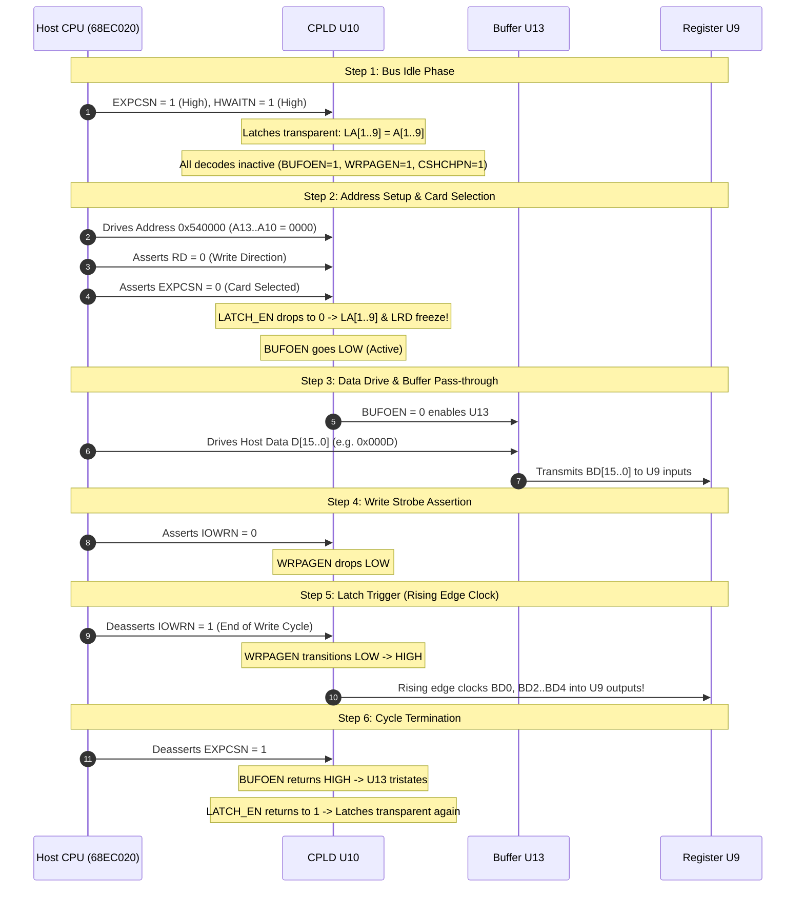
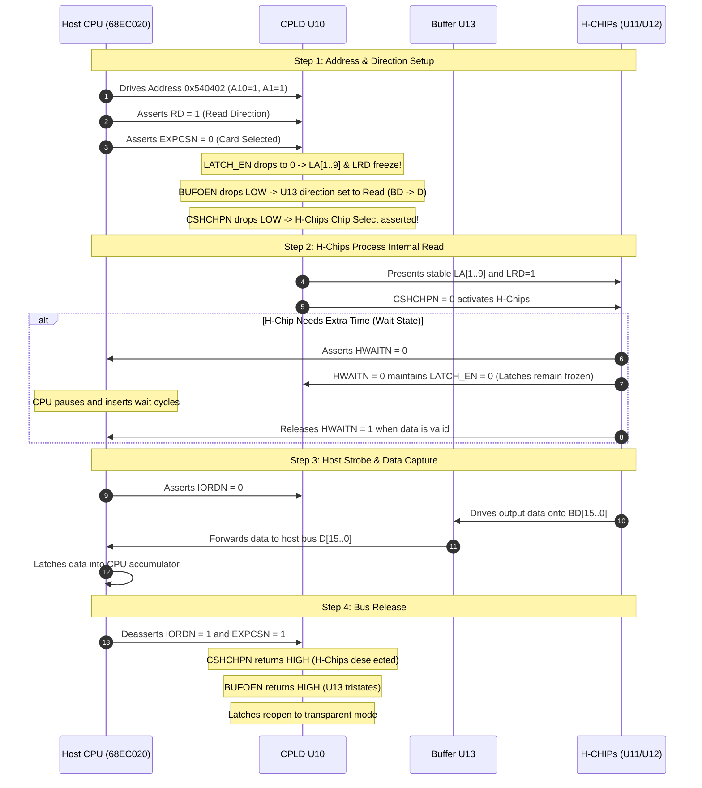

# E-mu PC510 / SK510 Rev A — U10 CPLD Operational Walkthrough & Bus Architecture
**How the E-mu Sampler Hosts, Decodes, and Interfaces with the PC510 Expansion Card via IC U10**

---

## 1. Executive Overview

On the **E-mu PC510 / SK510 Rev A** Digital Audio & 8-Analog Output expansion board, integrated circuit **`U10`** (originally an Altera **EPM7032LC44**, replaced by the Atmel/Microchip **ATF1502AS-10JU44**) serves as the **central expansion bus controller and gatekeeper**.

Whenever the E-mu sampler's host CPU (Motorola 68EC020 or ColdFire processor) needs to interact with the expansion card—whether setting audio routing registers or communicating with the custom **E-mu H-CHIP 1.5 ASICs**—all control strobes, direction lines, buffer enables, and address lines pass through and are conditioned by **`U10`**.

```mermaid
flowchart TD
    subgraph Host ["E-mu Sampler Motherboard (Host CPU)"]
        CPU_ADDR["Address Bus (A1..A13)"]
        CPU_CTRL["Control Strobes (EXPCSN, IORDN, IOWRN, RD, UPCLRN)"]
        CPU_DATA["Host Data Bus (D0..D15)"]
        CPU_WAIT["Hardware Wait / Handshake (HWAITN)"]
    end

    subgraph U10_PLD ["CPLD U10 (ATF1502AS / EPM7032)"]
        LATCH["Transparent Address Latch\nLA[1..9], LRD"]
        DEC["Address Decoder Logic"]
    end

    subgraph Peripherals ["PC510 Expansion Board Peripherals"]
        U13["U13 74ACTQ16245\n16-Bit Bi-Directional Bus Transceiver"]
        U9["U9 74ACT273\nAddress Page Register"]
        HCHIPS["H-CHIP 1.5 ASICs (#2 & #3)\nDigital Audio DSP & Routing"]
    end

    CPU_ADDR -->|A1..A9, A10..A13| U10_PLD
    CPU_CTRL --> U10_PLD
    CPU_WAIT --> U10_PLD

    DEC -->|BUFOEN (Active Low)| U13
    DEC -->|WRPAGEN (Active Low Strobe)| U9
    DEC -->|CSHCHPN (Active Low Chip Select)| HCHIPS
    LATCH -->|LA1..LA9 (Latched Addresses)| HCHIPS
    LATCH -->|LRD (Latched Direction)| HCHIPS

    CPU_DATA <-->|D0..D15 <--> BD0..BD15| U13
    U13 -->|BD0, BD2..BD4| U9
    U13 <-->|BD0..BD15| HCHIPS
```

---

## 2. Pin-by-Pin Operational Breakdown

### A. Host Input Lines (Signals Received by U10 from the Sampler)

| Signal | PLCC Pin | Origin | Description & Function |
| :--- | :---: | :--- | :--- |
| **`UPCLRN`** | **1** | Host `CN4-50` via R7 | **Global Hardware Reset (Active Low)**.<br>Held at +5V during normal operation. When the sampler is powering up or resetting, `UPCLRN` pulls LOW, forcing all outputs of `U10` into a high-impedance (tri-state) condition to prevent bus contention. |
| **`OE1`, `OE2`** | **44, 2** | Tied to `UPCLRN` | **Global Output Enables**.<br>Dedicated internal enable gates in the CPLD macrocell architecture. Tied to `UPCLRN` so the entire chip tristates during system reset. *(Pin 44 also acts as the +12V reflash override).* |
| **`EXPCSN`** | **4** | Host `CN4-48` | **Expansion Card Chip Select (Active Low)**.<br>The host motherboard asserts this line LOW whenever the CPU executes an instruction targeting the PC510 expansion slot's 16 KB memory window (`0x540000`–`0x543FFF`). |
| **`RD`** | **24** | Host `CN4-44` via R12 | **Bus Direction Strobe**.<br>Indicates cycle direction: **HIGH = Read** (data flows from expansion card to host), **LOW = Write** (host places data on bus to write into expansion card). |
| **`IORDN`** | **5** | Host `CN4-45` via R9 | **I/O Read Strobe (Active Low)**.<br>Pulsed LOW by the host CPU during read cycles to signal that valid read timing is active. |
| **`IOWRN`** | **21** | Host `CN4-46` via R11 | **I/O Write Strobe (Active Low)**.<br>Pulsed LOW by the host CPU during write cycles. Its rising edge marks the end of the write cycle. |
| **`A[1..13]`** | **6..20** | Host `CN4` | **Host Address Bus Lines**.<br>Address lines `A1` through `A13` define sub-ranges within the 16 KB expansion window (`A0` is handled by data bus byte-enables on the CPU motherboard). |
| **`HWAITN`** | **41** | Host `CN4-21` & Sheets 3, 4 | **Hardware Wait / Handshake (Active Low)**.<br>Driven LOW by the downstream H-Chips or digital audio hardware when they need extra time to complete a cycle. Also fed back into `U10` to keep address latches locked during wait cycles. |
| **`GCLK`** | **43** | Master clock via R61 | **22.5792 MHz Master Audio Clock (`C22M2`)**.<br>Connected to the global clock input for potential synchronous logic; routed to spare macrocells. |

---

### B. Board Output Lines (Signals Driven by U10 to Card Peripherals)

| Signal | PLCC Pin | Destination | What It Drives & Why |
| :--- | :---: | :--- | :--- |
| **`BUFOEN`** | **27** | `U13` Pins 25 & 48 (`1OE\`, `2OE\`) via R70 | **Data Buffer Output Enable (Active Low)**.<br>Controls the 16-bit bidirectional bus transceiver `U13` (`74ACTQ16245`). When `BUFOEN` is LOW, `U13` bridges the sampler's host data bus (`D0`–`D15`) to the expansion card's internal data bus (`BD0`–`BD15`). When HIGH, the card's data lines are fully isolated from the sampler. |
| **`WRPAGEN`** | **32** | `U9` Pin 11 (`CLK`) via R60 | **Write Page Register Strobe (Active Low)**.<br>Clocks `U9` (`74ACT273` Octal D-Latch). During a write to `0x540000`–`0x5403FF`, `WRPAGEN` goes LOW. On its **rising edge** at the end of the write strobe, bits `BD0, BD2, BD3, BD4` are latched into `U9` to set the H-Chip page register. |
| **`CSHCHPN`** | **38** | H-Chip 1.5 ASICs (`CSN`) via R15 | **H-Chips Chip Select (Active Low)**.<br>Enables ASIC #2 and ASIC #3 on Sheet 4. Active LOW whenever the host accesses addresses `0x540400`–`0x5407FF`. |
| **`LA[1..9]`** | **31, 34, 33, 28, 36, 39, 29, 25, 40** | H-Chips (`A1`–`A9`) via 47Ω damping resistors | **Latched Address Bus (Transparent Latches)**.<br>Provides stable, jitter-free address lines to the internal registers of the H-CHIPs. They follow `A1`–`A9` while the bus is idle, but lock frozen the instant `EXPCSN` or `HWAITN` asserts. |
| **`LRD`** | **37** | H-Chips (`RD`) via R16 | **Latched Read Strobe**.<br>Provides a latched copy of the bus direction line `RD` to the H-Chips so read/write direction does not bounce during wait states. |

---

## 3. Expansion Bus Address Space Decoding

The E-mu sampler reserves a **16 Kilobyte window** (`0x540000` to `0x543FFF`) for the PC510 expansion board. The board responds whenever `EXPCSN = 0`.

Within this 16 KB window, `U10` decodes address lines `A13`, `A12`, `A11`, and `A10` into three distinct functional zones:

```
+-------------------------------------------------------------------------+
|                  E-mu PC510 Expansion Window (16 KB)                     |
|                        0x540000 - 0x543FFF                              |
+-------------------------------------------------------------------------+
|  0x540000 - 0x5403FF  (1 KB)  |  Address Page Register (U9 74ACT273)    |
|                               |  Write only: Clocks WRPAGEN             |
|                               |  Data Buffer Enabled (BUFOEN = 0)       |
+-------------------------------+-----------------------------------------+
|  0x540400 - 0x5407FF  (1 KB)  |  H-CHIP 1.5 ASICs (ASIC #2 & #3)        |
|                               |  Read/Write: Asserts CSHCHPN            |
|                               |  Data Buffer Enabled (BUFOEN = 0)       |
+-------------------------------+-----------------------------------------+
|  0x540800 - 0x543FFF  (14 KB) |  Unassigned / Bus Isolated Zone         |
|                               |  Data Buffer Disabled (BUFOEN = 1)      |
|                               |  Prevents bus contention with host bus  |
+-------------------------------------------------------------------------+
```

### The Boolean Decode Equations Explained

#### 1. Data Bus Buffer Enable (`BUFOEN`)
```cupl
!BUFOEN = !EXPCSN & !A13 & !A12 & !A11;
```
* **Active Range:** `0x540000` to `0x5407FF` (the first 2 KB of the expansion space).
* **Operation:** 
  * `EXPCSN = 0` (card is addressed).
  * `A13 = 0, A12 = 0, A11 = 0` (address is below `0x540800`).
  * When both conditions are met, `BUFOEN` drops LOW, opening `U13` so data flows between the host and the expansion board.
* **Bus Protection:** If the CPU accesses `0x540800` through `0x543FFF` (where `A11=1`, `A12=1`, or `A13=1`), `BUFOEN` remains HIGH. `U13` stays in high-impedance mode, preventing the expansion card from driving or floating the host data bus.

#### 2. Address Page Register Clock (`WRPAGEN`)
```cupl
!WRPAGEN = !EXPCSN & !A13 & !A12 & !A11 & !A10 & !IOWRN;
```
* **Active Range:** `0x540000` to `0x5403FF` (Write Cycles Only).
* **Operation:** 
  * `EXPCSN = 0`, `A13..A11 = 0`.
  * `A10 = 0` selects the lower 1 KB block (`0x000`–`0x3FF`).
  * `IOWRN = 0` indicates a CPU write cycle.
  * When all terms are active, `WRPAGEN` drops LOW. When the CPU completes the write cycle and releases `IOWRN` back HIGH, `WRPAGEN` makes a clean **LOW-to-HIGH transition**, clocking the data bits into register `U9`.

#### 3. H-Chips Chip Select (`CSHCHPN`)
```cupl
!CSHCHPN = !EXPCSN & !A13 & !A12 & !A11 & A10;
```
* **Active Range:** `0x540400` to `0x5407FF` (Read or Write).
* **Operation:**
  * `EXPCSN = 0`, `A13..A11 = 0`.
  * `A10 = 1` selects the upper 1 KB block (`0x400`–`0x7FF`).
  * `CSHCHPN` drops LOW, asserting `CSN` on both H-CHIPs. The H-Chips then inspect `LA1`–`LA9` and `LRD` to determine which internal DSP register or audio buffer is being accessed.

---

## 4. Step-by-Step Bus Cycle Walkthroughs

### Walkthrough 1: Host CPU Writes to the Address Page Register (`U9`)
*(Example: Host CPU configures audio memory banking at address `0x540000`)*



---

### Walkthrough 2: Host CPU Reads from H-CHIP ASICs
*(Example: Host CPU reads DSP status or audio data from address `0x540402`)*



---

## 5. The Transparent Latch Architecture (`LA1`–`LA9`, `LRD`)

### Why Latches Were Used Instead of Direct Wires
In high-speed 68000/ColdFire microprocessor architectures, the CPU address bus transitions **before, during, and immediately after** control strobes change. Slower peripheral ASICs like the E-mu H-CHIPs have strict setup and hold time requirements:
* If the address lines wobble while the ASICs are processing an internal audio read/write, internal register pointers can corrupt.
* The original E-mu engineers solved this by designing **transparent latches directly into the CPLD macrocells**.

### How the Logic Works Inside U10
```cupl
LATCH_EN = EXPCSN & HWAITN;

LA1 = (LATCH_EN & A1) # (!LATCH_EN & LA1);
...
LA9 = (LATCH_EN & A9) # (!LATCH_EN & LA9);
LRD = (LATCH_EN & RD) # (!LATCH_EN & LRD);
```

This is the classic sum-of-products implementation of a **transparent D-latch with feedback**:

1. **When the bus is idle (`EXPCSN = 1` and `HWAITN = 1`):**
   * `LATCH_EN = 1`
   * `LAx = (1 & Ax) # (0 & LAx) = Ax`
   * **Result:** The latch is fully **transparent**. Whatever address is on `A1`–`A9` flows directly through to `LA1`–`LA9` with zero propagation delay overhead.

2. **The instant the CPU selects the card (`EXPCSN = 0`) OR a wait occurs (`HWAITN = 0`):**
   * `LATCH_EN = 0`
   * `LAx = (0 & Ax) # (1 & LAx) = LAx`
   * **Result:** The latch **freezes immediately**. Even if the CPU address bus fluctuates, the H-CHIPs see rock-solid, static address lines throughout the entire transaction.

3. **When the transaction concludes (`EXPCSN` returns to 1):**
   * `LATCH_EN` returns to 1, reopening the latch in preparation for the next cycle.

---

## 6. System Reset & Tristate Security (`UPCLRN`)

At system power-on, the host sampler asserts `UPCLRN = 0` (via motherboard connector `CN4-50`). 

In `U10`, every single output pin has its Output Enable conditioned by `UPCLRN`:
```cupl
[LA1..9].oe = UPCLRN;
LRD.oe     = UPCLRN;
CSHCHPN.oe = UPCLRN;
WRPAGEN.oe = UPCLRN;
BUFOEN.oe  = UPCLRN;
```

* **During Reset (`UPCLRN = 0`):**
  * All 13 output pins of `U10` are held in **High-Z (tri-state)**.
  * Pull-up resistors on the PC510 card (such as `R15`, `R60`, and `R70`) safely pull `BUFOEN`, `WRPAGEN`, and `CSHCHPN` HIGH to their inactive states.
  * This guarantees that during sampler bootup, no spurious writes can trigger the page register or disturb the audio DACs and ASICs.

* **After Bootup (`UPCLRN = 1`):**
  * All macrocells enable their push-pull output drivers, and normal bus decoding begins.

---

## 7. Summary Table: Logic State Truth Table

| State / Cycle Type | `EXPCSN` | `A13..A11` | `A10` | `IOWRN` | `IORDN` | `BUFOEN` | `WRPAGEN` | `CSHCHPN` | Latch Status |
| :--- | :---: | :---: | :---: | :---: | :---: | :---: | :---: | :---: | :--- |
| **Bus Idle** | `1` | X | X | `1` | `1` | `1` (Off) | `1` (Off) | `1` (Off) | Transparent (`LA=A`) |
| **Write Page Reg (0x540000)** | `0` | `000` | `0` | `0` | `1` | **`0` (Active)** | **`0` (Strobe)** | `1` (Off) | **Locked / Frozen** |
| **Read Page Reg (0x540000)** | `0` | `000` | `0` | `1` | `0` | **`0` (Active)** | `1` (Off) | `1` (Off) | **Locked / Frozen** |
| **Write H-Chips (0x540400)** | `0` | `000` | `1` | `0` | `1` | **`0` (Active)** | `1` (Off) | **`0` (Active)** | **Locked / Frozen** |
| **Read H-Chips (0x540400)** | `0` | `000` | `1` | `1` | `0` | **`0` (Active)** | `1` (Off) | **`0` (Active)** | **Locked / Frozen** |
| **Unmapped Access (>0x5407FF)**| `0` | $\neq 000$ | X | X | X | `1` (Off) | `1` (Off) | `1` (Off) | **Locked / Frozen** |
| **System Reset (`UPCLRN=0`)** | X | X | X | X | X | **High-Z** | **High-Z** | **High-Z** | **High-Z (Tri-state)** |
